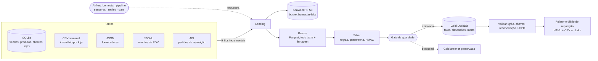

# Drogaria Bem-Estar — Plataforma de Dados

Rede de 20 farmácias que perde venda por **ruptura** e dinheiro por **produto vencido**. A plataforma ingere 5 fontes, passa por Landing → Lake (SeaweedFS/S3) → Bronze → Silver (qualidade + quarentena) → gate → Gold (DuckDB) e entrega todo dia o **relatório de reposição**: o que repor (com o prazo *real* de cada distribuidor), o que transferir entre lojas, os lotes que vão vencer antes de vender, a pontualidade dos distribuidores e a perda por vencimento.

## Arquitetura



## Pré-requisitos
- Linux/macOS (bash) **ou** Windows 11 (PowerShell + WSL Ubuntu-24.04 para o Airflow), Python 3.13.
- SeaweedFS: baixar o binário `weed` em <https://github.com/seaweedfs/seaweedfs/releases> e colocar em `tools/seaweedfs/` (`weed.exe` no Windows). Não é versionado.
- A pasta `fontes/` do cenário (já no repositório de entrega).

## Como rodar do zero (Linux/macOS)

```bash
python3.13 -m venv .venv && . .venv/bin/activate
python -m pip install -r requirements.txt
export PYTHONPATH=. PYTHONUTF8=1

# terminal 2: API do distribuidor (fonte 5)
python -m uvicorn api.app:app --host 127.0.0.1 --port 8001
# terminal 3: Data Lake local
AWS_ACCESS_KEY_ID=admin AWS_SECRET_ACCESS_KEY=bigdata-secret tools/seaweedfs/weed mini -dir data/seaweedfs

# terminal 1: pipeline completo (mesma ordem do DAG)
export AWS_ACCESS_KEY_ID=admin AWS_SECRET_ACCESS_KEY=bigdata-secret
export PSEUDO_CHAVE="<escolha uma chave secreta>"
python -m pipeline.lake.sync --criar-bucket
bash tools/rodar_local.sh            # --sem-lake roda sem o SeaweedFS
```

Windows: `py -3.13 -m venv .venv`, `.\.venv\Scripts\Activate.ps1`, `$env:PSEUDO_CHAVE="..."` e `.\tools\rodar_local.ps1`.

Rodar de novo, sem dado novo, **não captura nada e não muda nenhuma contagem** (idempotente).

## Airflow (DAG `bemestar_pipeline`)

```bash
bash tools/instalar_airflow.sh        # Ubuntu/WSL: wsl -d Ubuntu-24.04 -- bash tools/instalar_airflow.sh
bash tools/iniciar_airflow.sh         # interface em http://localhost:8080
bash tools/criar_conexoes.sh          # Connections lake_s3 e api_fonte + Variable pseudo_secret ("<chave>" ou $PSEUDO_CHAVE)
```
Acione o DAG `bemestar_pipeline`. Grupos: **sensores** (API responde, Lake aceita a credencial; credencial recusada falha na hora, serviço fora do ar espera e tenta de novo) → **ingestão** (5 ELs em paralelo) → Landing no Lake → **transformação** (Bronze, Silver, **gate** com o parâmetro `max_quarentena_pct`, padrão 3) → **warehouse** (Gold, validar) → **publicação** (Lake) e **produto de dados**. Se o gate bloqueia, a Gold anterior continua intacta.

## Produto de dados
`python -m pipeline.produto.executar` gera `data/produtos/relatorios/relatorio_AAAA-MM-DD.html` (abra no navegador) e as listas `data/produtos/listas/{repor,risco}_AAAA-MM-DD.csv`, publicados no Lake em `relatorios/` (relatórios anteriores são preservados). As 5 perguntas da diretoria estão em `sql/perguntas_negocio.sql`:
`python -m pipeline.consulta sql/perguntas_negocio.sql`

## Lote incremental (Etapa 10)
O `lote_incremental/aplicar_lote.py` do professor não veio no material. `tools/simular_lote.py` **simula** um lote 01–14/10/2026 (clientes e produtos novos/atualizados, reajustes de preço, vendas, entregas de pedidos em trânsito, contagens de 05/10 e 12/10, nova versão de `fornecedores.json`), com semente fixa e idempotente. Os números do relatório vindos dele são rotulados **simulados**. Evidências: `docs/contagens_antes_do_lote.txt`, `docs/contagens_depois_do_lote.txt`, `docs/avaliacao_produto.txt` (`sql/avaliacao_produto.sql`).
Para voltar ao estado original: restaurar `fontes/` e apagar `data/`.

## Credenciais do laboratório
`admin` / `bigdata-secret` (SeaweedFS) aparecem nos scripts porque são as credenciais **do laboratório local**, sem valor fora dele. Numa empresa viriam de um cofre de segredos. A chave de pseudonimização **não** está no código: vem de `PSEUDO_CHAVE` (ou da Variable `pseudo_secret` do Airflow).

## Estrutura

| Pasta | Responsabilidade |
| --- | --- |
| `fontes/`, `api/` | dados do cenário e API do distribuidor |
| `pipeline/el/` | 5 ELs incrementais (watermark, SHA-256, `after_sequence`) → Landing |
| `pipeline/lake/sync.py` | envio ao SeaweedFS só do novo/alterado (`--espelhar` nas camadas derivadas) |
| `pipeline/transform/` | `bronze.py`, `silver.py` (regras + quarentena), `gate.py`, `gold.py`, `validar.py` |
| `pipeline/lgpd/` | pseudonimização HMAC-SHA256 |
| `pipeline/produto/` | relatório diário de reposição |
| `dags/pipeline_dag.py` | DAG do Airflow |
| `sql/` | contagens por camada, 5 perguntas, avaliação do produto |
| `tools/` | instalar/iniciar Airflow, conexões, execução local, simulador de lote |
| `docs/` | diário de descobertas, inventário LGPD, relatório final, evidências |
