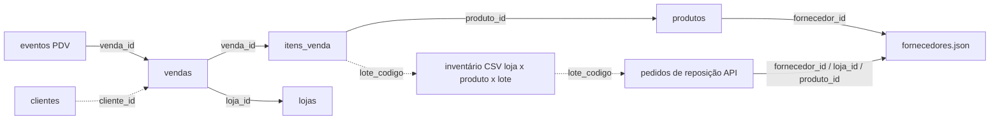

# Diário de descobertas — Etapa 1

## 1. Contagens (fontes originais, antes do lote)

| Fonte | Conteúdo | Linhas |
| --- | --- | --- |
| SQLite `lojas` | 20 lojas (RJ, Niterói, São Gonçalo) | 20 |
| SQLite `produtos` | 73 produtos, 8 fornecedores | 73 |
| SQLite `clientes` | cadastro | 4.163 |
| SQLite `vendas` / `itens_venda` | 01/06 a 30/09/2026 | 36.357 / 50.350 |
| CSV `inventario/AAAA-MM-DD/loja_NN.csv` | contagem semanal (segundas), 18 semanas × 20 lojas | 34.895 |
| JSON `fornecedores.json` | cadastro de distribuidores | 9 registros (8 ids) |
| JSONL `events/pdv_*.jsonl` | eventos do PDV, 122 arquivos diários | 61.212 |
| API `pedidos-reposicao` | pedidos de reposição, paginados por `sequencia` | 7.691 |

## 2. Como as fontes se ligam

O lote (`Lppp-nnnn`, ppp = produto) é a chave que costura inventário, vendas e pedidos: é ele que permite saber **qual lote vence**.

## 3. Linha do tempo de estoque (item 1.4)

Loja 1, contagens de segunda 21/09 e 28/09 (baixa = vendas concluídas do lote de 21/09 a 27/09; sem entrega no período):

| Lote | Contagem 21/09 | Vendas 21–27/09 | Esperado | Contagem 28/09 | Fecha? |
| --- | --- | --- | --- | --- | --- |
| L011-0126 (produto 11) | 8 | 5 (22, 24, 26/09) | 3 | 3 | sim |
| L023-0089 (produto 23) | 11 | 2 | 9 | 9 | sim |
| L026-0131 (produto 26) | 9 | 1 | 8 | 6 | não (2 unidades a menos) |

Na base inteira, 97% das semanas por lote fecham exatamente: o estoque pode ser **estimado** = última contagem − vendas do lote desde então + entregas. Os ~3% restantes (quebra, furto, erro de contagem) viram o ruído da estimativa, documentado no relatório.

## 4. Como calculo os dias de estoque (item 1.6)

`dias de estoque = estoque vendável estimado ÷ taxa diária`, com taxa = unidades vendidas nos últimos 28 dias ÷ 28 e estoque vendável = só lotes **não vencidos**. Compara-se a cobertura (estoque + em trânsito) com o prazo **real** (p90) do distribuidor, não com o prometido.

## 5. Suspeitas de qualidade (todas confirmadas e tratadas no pipeline)

| # | Suspeita | Evidência | Tratamento |
| --- | --- | --- | --- |
| 1 | `produto_id = 9999` não existe em `produtos`, e aparece em itens, inventário, pedidos | 45 itens, 66 contagens, 16 pedidos | quarentena (`produto_inexistente`) |
| 2 | Validade do inventário em `MM/AAAA` | 5.124 linhas | 4.299 resolvidas pela data exata do mesmo lote na API; 825 viram o último dia do mês |
| 3 | Eventos duplicados (reenvio do PDV) e sem tipo | 519 duplicados, 84 sem tipo | primeira ocorrência fica; sem tipo vai para quarentena |
| 4 | Horário de evento em UTC (`Z`) e eventos em arquivo de outro dia | 115 convertidos, 916 atrasados | converte para Brasília; a data vale pela hora do evento |
| 5 | Fornecedores: id repetido com dados diferentes, prazo escrito "2 dias", pedido mínimo negativo, CNPJ ausente | 1 duplicado, 1 texto, 1 sinal invertido, 1 sem CNPJ | fica a versão cujo prazo concorda com a API; texto vira número; sinal corrigido (hipótese documentada); alerta |
| 6 | Valor total de venda negativo com itens positivos | 67 vendas | sinal invertido corrigido (conferido: \|valor\| = soma dos itens) |
| 7 | Status de pedido com variantes (`ENTREGUE`, `entregue `, `em transito`) e status incoerente com a data de entrega | 13 padronizados, 6 ambíguos | padroniza; ambíguos vão para quarentena |
| 8 | Contagem negativa, linha de inventário duplicada, entrega antes do pedido | 104, 178, 27 | quarentena |
| 9 | Lote do item de venda pertence a outro produto | 45 itens | quarentena (`lote_incompativel_com_produto`) |
| 10 | Prazo previsto nos pedidos difere do prazo cadastrado do fornecedor (cadastro desatualizado ou promessa diferente) | 2.415 pedidos | alerta; o produto usa o prazo **real** medido |

## 6. Descobertas de negócio que moldaram o modelo

- Dois distribuidores (Nova Saúde Atacadista e Profarma Leste) entregam no prazo combinado em apenas ~35% dos pedidos (p90 real de 9 dias contra 2 combinados). Repor com base no prazo prometido deixaria essas lojas sem estoque.
- O inventário é semanal; o estoque de hoje só existe como estimativa. A "foto" de segunda é a âncora.
- O custo de compra não está em nenhuma fonte: perdas e valores em risco são calculados a **preço de venda**.
